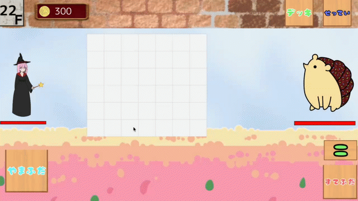
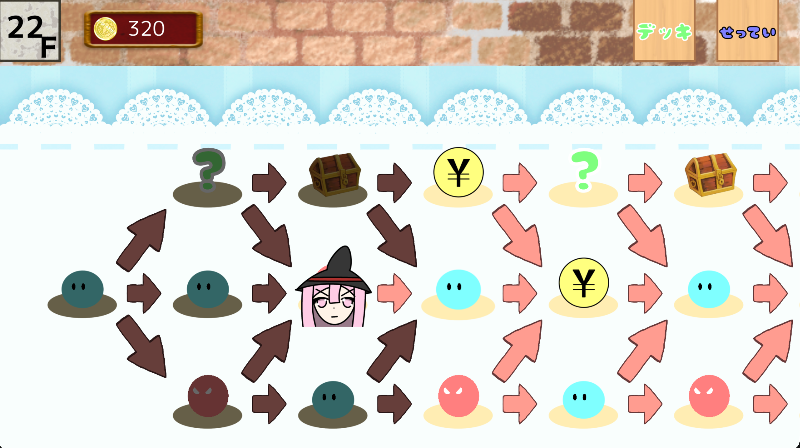
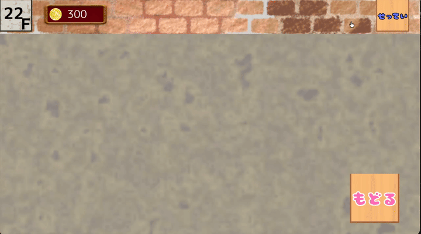
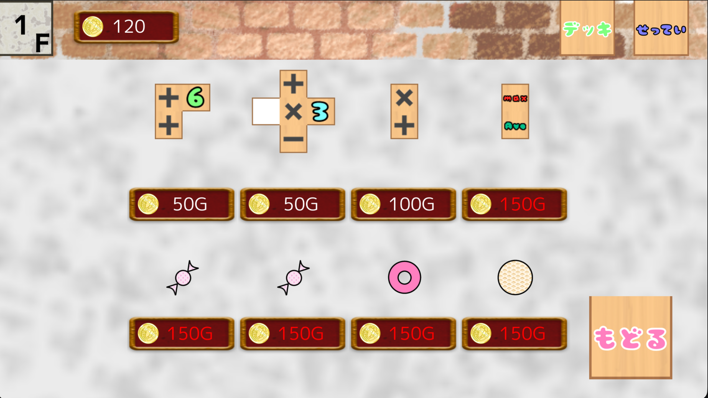

# Make10sion


Make10sionは，`Make10`というパズル要素を戦闘に取り入れたローグライクゲームである．

Make10 とは，数字(1~9)と四則演算子(+,-,x,÷)を組み合わせて`10`を作るパズルである．
この数字と演算子を組み合わせて目的の値を作るという要素を敵と戦う手段として取り入れた．
戦闘では，そのターンにおける敵の攻撃力・防御力を見ながら，
カード自体の`形状`や`回転`操作，配置する`位置`を考えて盤面上に数式を組み立てる．
配置によって攻撃・防御の割り当てや倍率が変わるため，同じ手札でも配置の仕方によって戦闘が大きく変化し得る．

繰り返しの戦闘による報酬や道中のショップなどのイベントを通じて，カードやレリックを獲得し，
デッキの選択肢や使用できる盤面が広がり，より複雑な数式を組み立てられるようになる．

## 画面構成

### 戦闘シーン



`やまふだ`から配られた手札を`盤面`に配置する．相手の攻撃力や防御力などを考慮し，カードの回転も駆使しながら数式を組み立てていく．
基本的に`上段`は攻撃力，`下段`は防御力として集計され，外側の行ほど`倍率`が高くなる．`特殊カード`によって行の役割や倍率の値を変更することもできる．
`=` を押すと盤面の状態が確定し，攻撃力・防御力に応じたダメージ処理が順に行われる．盤面に配置した手札や余った手札は`すてふだ`に移動する．

（GIF が表示されない場合は [こちら](docs/movies/battle-flow.mp4)）

### マップ



通常敵やボスとの対戦・ショップ・宝箱などから次のイベントを選択する．

### デッキ一覧



戦闘中に，所持しているデッキを確認できる．次のターンで，手札に来る可能性のあるカードを考慮し，今のターンの選択を考える材料となる．

(GIF が表示されない場合は [こちら](docs/movies/deck-view.mp4))

### ショップ



新しいカードやレリックを購入できる．限られた所持金を使って直近の戦闘を有利にするか，温存して後のより強力なデッキやレリックを購入するかを判断する．

## 開発環境とビルド

言語は C++，フレームワークは OpenSiv3D v0.6.16 を使用している．
ソースからビルドする場合は，OS ごとに対応する Siv3D SDK と開発ツールを用意する．

### macOS

[Siv3D 公式の macOS 向け導入手順](https://siv3d.github.io/ja-jp/download/macos/)に従い，
v0.6.16 のプロジェクトテンプレートをダウンロードして展開する．
ビルドには Xcode 本体が必要であり，Command Line Tools 単体ではビルドできない．
Xcode を一度起動してライセンス同意と初期設定を済ませ，使用する Command Line Tools に Xcode を選択する．

このプロジェクトのビルド対象は macOS 12.0 以降の `x86_64` である．
Apple Silicon Mac での実行には [Rosetta 2](https://support.apple.com/ja-jp/102527) が必要となる．
ビルドは macOS 27.0・Xcode 27.2 の環境で確認した．

展開したテンプレート内で，リポジトリを次の位置に配置する．

```text
siv3d_v0.6.16_macOS/
├── include/
├── lib/
└── examples/
    └── make10sion/   # このリポジトリ
```

リポジトリのルートで，次を実行する．

```sh
zsh macos/build-debug.sh && zsh macos/run-debug.sh
```

デモモードを遊ぶ場合は，起動後にタイトル画面の右下にある「デモモード」を選択する．

Visual Studio Code を使う場合は，以下のタスクからも実行できる．
VS Code は任意であり，ターミナルからビルド・起動する場合は必要ない．

| タスク | 用途 |
| --- | --- |
| `Build and Run on macOS` | ビルドしてタイトル画面から起動 |
| `Build on macOS` | ビルドのみ |
| `Run on macOS` | ビルド済みのアプリを起動 |

### Windows

[Siv3D 公式の Windows 向け導入手順](https://siv3d.github.io/ja-jp/download/windows/)に従い，
OpenSiv3D v0.6.16 と Visual Studio 2022 17.14 以降を導入する．
Visual Studio には「C++ によるデスクトップ開発」と MSVC v143 ビルドツールを追加する．
SDK の配置先を環境変数 `SIV3D_0_6_16` に設定する．公式インストーラを使用した場合は自動的に設定される．

`windows/make10sion.sln` を開き，`Release | x64` を選択してビルドする．
実行ファイルは `windows/App/make10sion.exe` にコピーされる．
開発用のビルドには `Debug | x64` も用意している．
